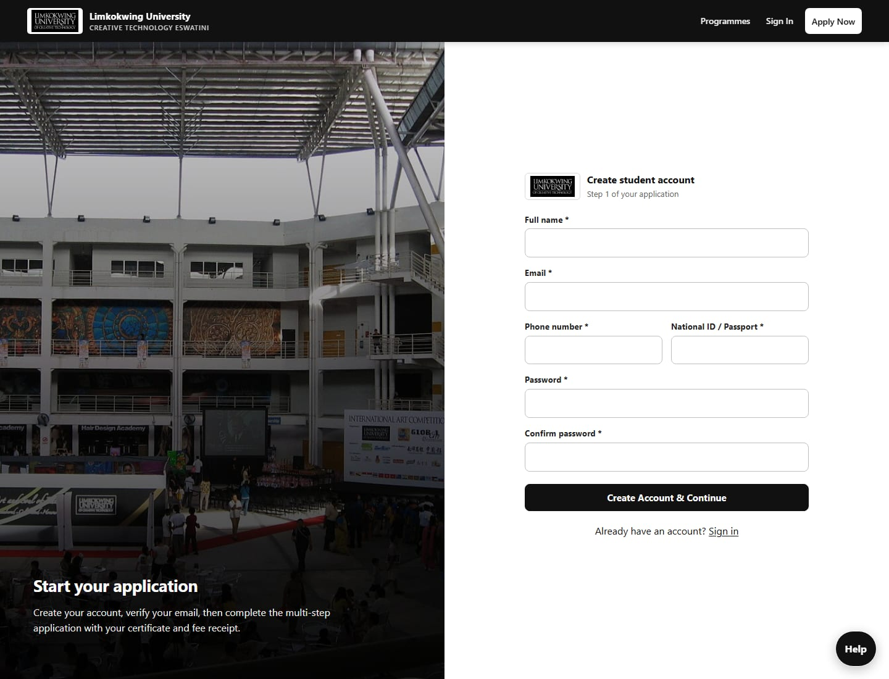
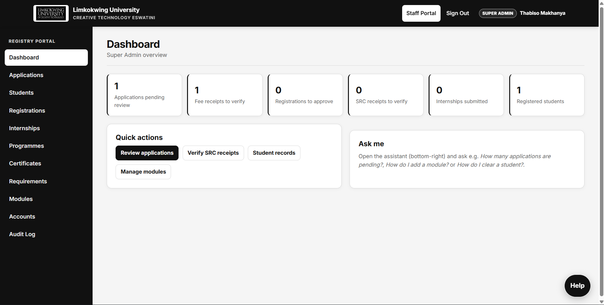
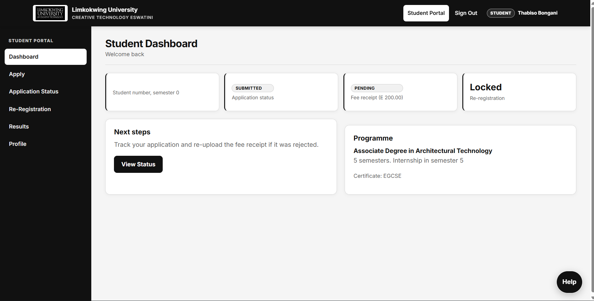

# Limkokwing Eswatini Registration Portal

A responsive admissions and semester registration portal for Limkokwing University of Creative Technology, Eswatini. The application combines a public programme catalogue, student self-service, staff administration, document handling, and a role-aware help assistant.

## Live application

- [Open the Vercel website](https://limkokwing-registration.vercel.app)
- [Check API health](https://limkokwing-registration.vercel.app/api/health)

## Screenshots

The account creation screen below is captured from the portal browser interface.



The staff screenshot shows the signed-in Super Admin dashboard, including its review queue and quick actions.



The student screenshot shows the signed-in student dashboard, including application status, fee-receipt status, and programme details.



## What the system does

### Public portal

Visitors can browse the published programme catalogue and view admission requirements where verified requirements have been entered. Programme requirements are associated with a certificate type, including EGCSE, IGCSE, or SAC. Public pages do not expose student records. The Apply Now route starts student account creation.

### Student portal

Students create an account, verify their email, then complete a multi-step application covering personal and contact details, programme and certificate selection, academic history, supporting documents, and registration-fee receipt. The portal tracks application and receipt review status.

Eligible students can preview modules scheduled for the next semester, select available minor or elective modules, upload the mandatory SRC receipt, and submit re-registration. The server checks clearance, pending modules, prerequisites, semester module availability, and required uploads. Final-semester students can submit internship placement details and documents. Students can also view their results and profile.

### Staff portal and access roles

Role checks run on protected API routes. The interface also limits navigation by role, but that client-side navigation is not the security boundary.

| Role | Main responsibilities |
| --- | --- |
| Super Admin | Full staff administration: create staff accounts; manage programmes, certificates, admission requirements, and modules; review applications; perform admissions and registry actions; view audit information; export data; and perform reasoned overrides. |
| Admissions Officer | Verify first-time fee receipts and academic certificates; review applications; accept or reject applications and assign student numbers. |
| Registry Officer | Enter module grades; set re-registration clearance; verify SRC receipts; approve semester registrations; record internship grades. |
| Registrar | Review records, perform reasoned manual overrides, and export data. |
| Student | Manage their own profile and application, submit registration documents, register for semesters, and view their own results and status. |

The Super Admin creates other staff accounts from **Admin > Accounts**. The seed creates only the Super Admin account. The Super Admin adds modules in Module Management and assigns each module to a programme and scheduled semester, with credits, classification, and prerequisites. Existing modules can be reassigned there; server validation checks semester bounds and keeps prerequisites within the assigned programme. The module catalogue starts empty, and removal is a soft delete to preserve historical records.

### Help assistant

The help widget is available across the site. Public questions use published programme and admission data. Student requests are scoped to the signed-in student's records, and staff responses are restricted by the signed-in user's role. When the assistant cannot answer, it shows a relevant department contact.

## Technology and project layout

- **Server:** Node.js, Express, and PostgreSQL (`pg`). Neon Postgres is supported through `DATABASE_URL`.
- **Authentication:** JWT tokens, password hashing with `bcryptjs`, email verification links, and server-side role middleware.
- **Frontend:** Responsive HTML, CSS, and JavaScript single-page interface.
- **Uploads:** `multer` with `sharp` image compression. Files are limited to 5 MB; images larger than 2 MB are resized and compressed.
- **Hosting:** Vercel serves the frontend and Express API from the same project.

```text
public/                 Frontend, styles, and downloaded image assets
server/app.js           Express application and API/static routing
server/auth.js          Authentication and role middleware
server/db.js            PostgreSQL pool and schema initialization
server/seed.js          Initial database catalogue and Super Admin
server/catalogue.js     Public programme catalogue helpers
server/routes/          Authentication, applications, registration, admin, and chatbot APIs
server/migrations/      Safe additions for existing databases
docs/screenshots/       README interface screenshots
```

## Run locally

Requirements: Node.js 20+ and a PostgreSQL database. Neon Postgres is supported.

1. Install dependencies:

   ```bash
   npm install
   ```

2. Copy `.env.example` to `.env`. Set these values:

   - `DATABASE_URL`: PostgreSQL connection string.
   - `JWT_SECRET`: a long, randomly generated secret.
   - `BOOTSTRAP_SUPER_ADMIN_PASSWORD`: a unique password of at least 12 characters for the initial administrator.
   - `PORT`: optional; defaults to `4000`.

3. Initialize a new database and create its initial records:

   ```bash
   npm run seed
   ```

   **Warning:** the default seed resets the target database before inserting its records. Use it only on a new or intentionally disposable database. Do not rerun it on a database containing student, staff, or registration records.

4. Start the development server:

   ```bash
   npm run dev
   ```

5. Open [http://localhost:4000](http://localhost:4000).

The production start command is `npm start`.

## Initial administrator

The seed creates one account:

- **Email:** `bonganithabiso84@gmail.com`
- **Password:** the value of `BOOTSTRAP_SUPER_ADMIN_PASSWORD` used for seeding

There are no demo student or staff accounts. Sign in as the Super Admin to create staff accounts. Keep the bootstrap password and database connection private; do not commit `.env`.

## Database and admission data

The schema stores users, students, certificates, programmes, certificate-specific requirements, modules and prerequisites, applications, semester registrations, receipts, enrolments, grades, clearance, internship placements, audit events, and assistant conversations.

The seed adds EGCSE, IGCSE, and SAC certificates; the IT programme examples; the Limkokwing Eswatini programme names compiled from published sources; sample certificate-specific requirements for the IT examples; and the grading scale. Published programme lists do not define certificate-specific cut-offs or subject requirements for every programme. Staff should confirm admission criteria with the University before entering and publishing them. Unverified requirements are not invented for the additional catalogue entries.

For an existing database, add missing researched programme rows without resetting user or registration data by running:

```bash
node server/migrations/2026-11-22-eswatini-programmes.js
```

Sources: [Eswatini Higher Education Council, Higher Education Institutions list (August 2026)](https://eshec.org.sz/wp-content/uploads/2026/08/ESHEC-HEI-List-Aug-2026_Final_V8.pdf); [Government of Eswatini, Priority Programmes of Study 2023-2027](https://www.gov.sz/images/MinistryOfLabour/PRIORITY%20LIST%202023-%202027%20MARCH%202%202_250312_154639.pdf).

## Deploy to Vercel

The production site is [limkokwing-registration.vercel.app](https://limkokwing-registration.vercel.app). Configure these **Production** environment variables in Vercel:

- `DATABASE_URL` — Neon Postgres connection string.
- `JWT_SECRET` — long, random token-signing secret.
- `BOOTSTRAP_SUPER_ADMIN_PASSWORD` — needed only when initializing the database with the seed.

Initialize an empty production database once from a trusted local environment with the production database URL and bootstrap password, then deploy:

```bash
npm install
npm run seed
npx vercel --prod --yes
```

Do not run `npm run seed` again after the database contains real records. To publish later code changes, deploy with `npx vercel --prod --yes`.

Verify the deployment with:

```bash
npx vercel curl https://limkokwing-registration.vercel.app/api/health
npx vercel curl https://limkokwing-registration.vercel.app/api/public/programmes
```

Vercel function filesystems are temporary. Configure persistent object storage before relying on uploaded student documents in production. Email verification and decision notifications currently use the development mail logger; configure a real email provider before relying on outbound email delivery.

## Fees and file rules

The first-time registration fee is **E 200.00**. First-time applicants must upload its receipt. Semester re-registration requires an SRC subscription receipt. Internship registrations also require placement documents.

The upload endpoint accepts PDF, JPG, PNG, and WEBP files up to 5 MB. Images above 2 MB are compressed or resized automatically. File access is routed through authenticated handlers that check ownership and staff permissions.

## Tests

The API suite creates and changes records. Run it only against a disposable PostgreSQL/Neon branch:

```bash
npm test
```

## Troubleshooting

- **API says the database is not configured:** add `DATABASE_URL` to the correct Vercel environment and redeploy.
- **Vercel function fails:** inspect deployed function logs with `npx vercel logs --deployment https://limkokwing-registration.vercel.app --since 30m`.
- **Programme list is empty on a new database:** initialize it with the seed. For an existing database, use the programme migration above.
- **Uploads disappear after deployment:** configure persistent object storage; Vercel's function filesystem is not durable.
